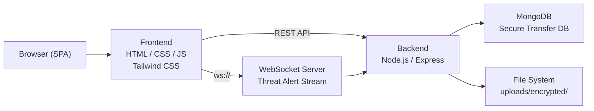
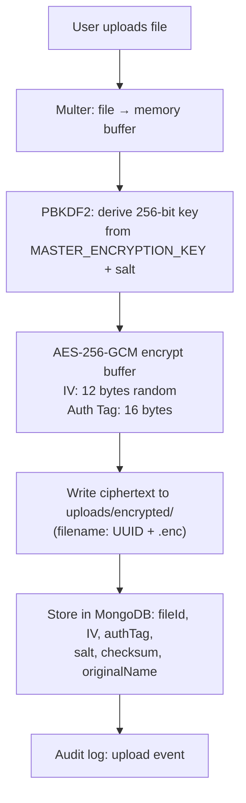
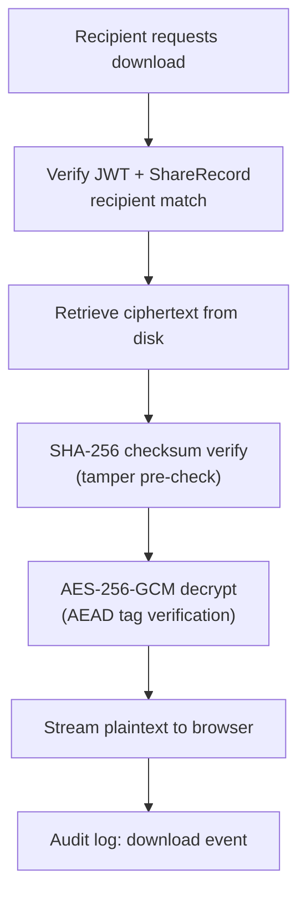
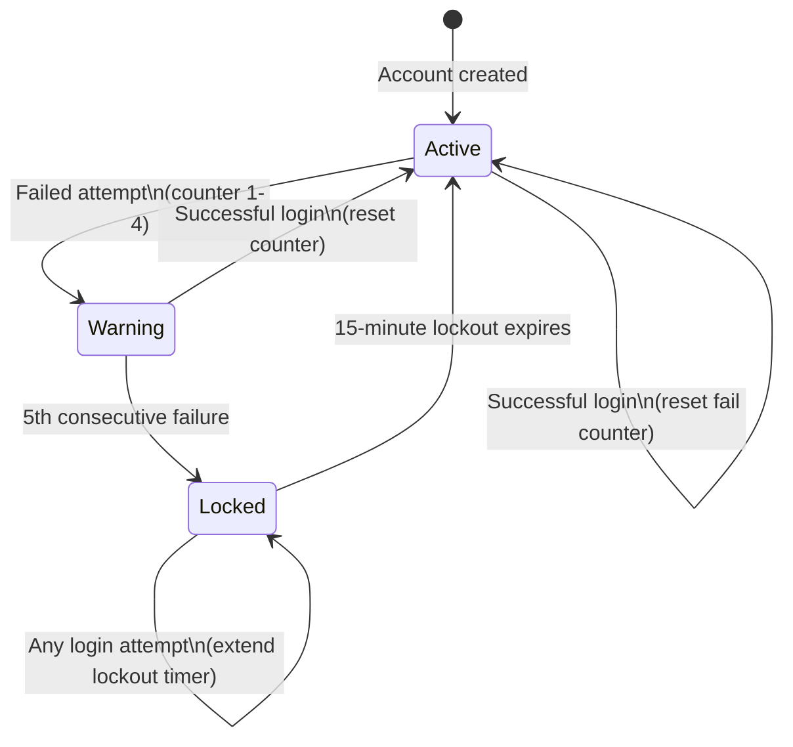
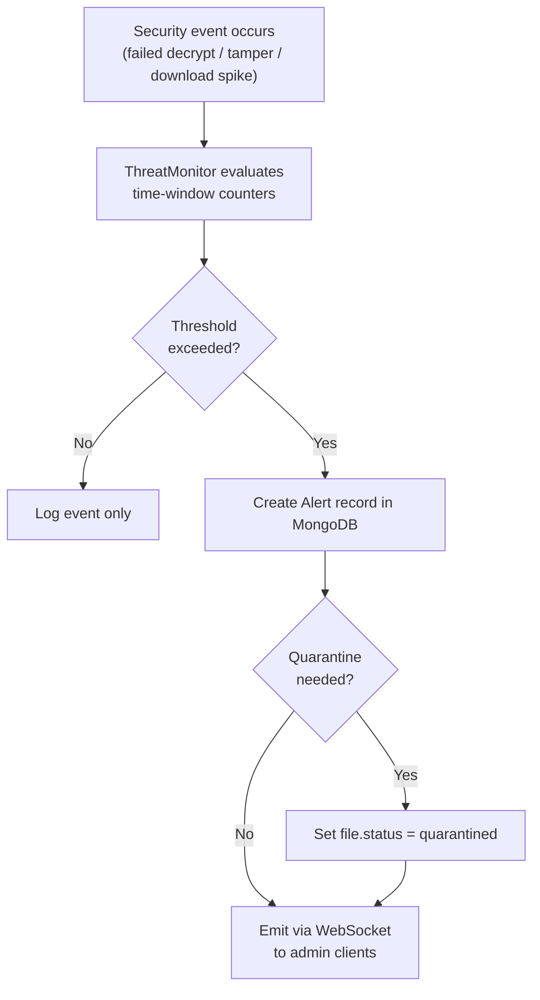
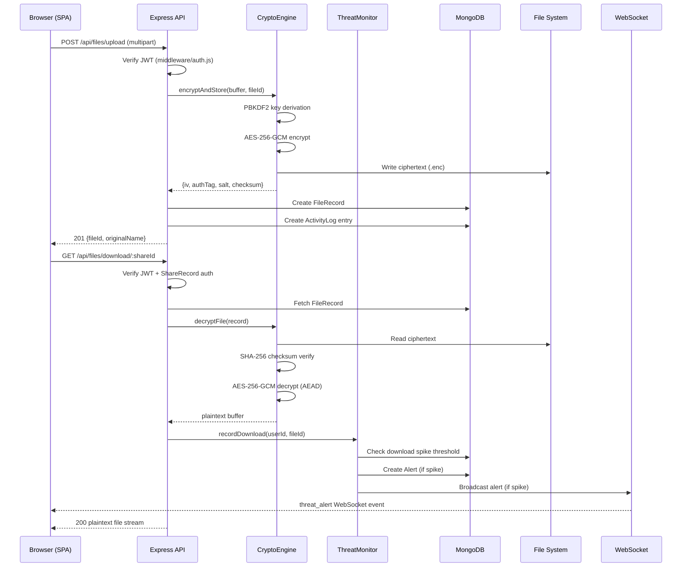
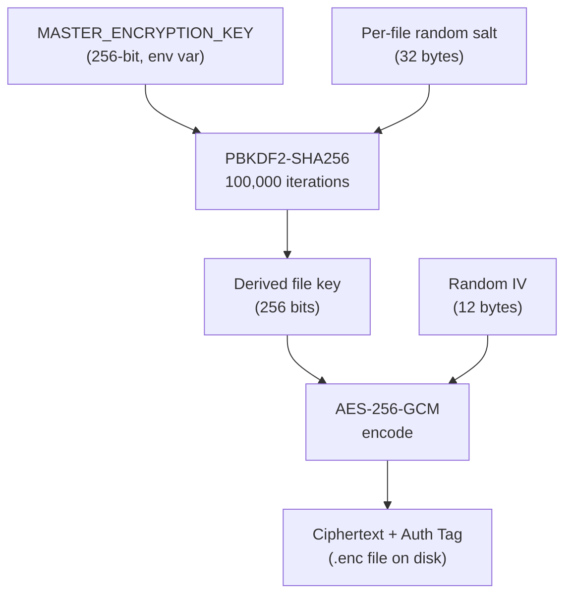

# Software Requirements Specification (SRS)
## CipherDrop — Secure File Transfer & Threat Monitoring Platform
**Version 1.0 | November 2026**  
**Document Status:** Approved  
**Classification:** Internal — Engineering Reference

---

## Table of Contents

1. [Introduction](#1-introduction)
2. [Overall Description](#2-overall-description)
3. [External Interface Requirements](#3-external-interface-requirements)
4. [System Features](#4-system-features)
5. [Non-Functional Requirements](#5-non-functional-requirements)
6. [System Architecture](#6-system-architecture)
7. [Appendix — Requirements Traceability Matrix](#7-appendix--requirements-traceability-matrix)

---

## 1. Introduction

### 1.1 Purpose

This Software Requirements Specification (SRS) defines the functional and non-functional requirements for **CipherDrop**, a web-based secure file transfer and real-time threat monitoring platform. The document establishes a binding reference for design, implementation, testing, and audit activities.

### 1.2 Document Conventions

| Convention | Meaning |
|---|---|
| **REQ-N** | Uniquely numbered functional requirement |
| **SHALL** | Mandatory requirement |
| **SHOULD** | Recommended but not mandatory |
| **MAY** | Optional capability |
| **AES-256-GCM** | Advanced Encryption Standard, 256-bit key, Galois/Counter Mode |
| **AEAD** | Authenticated Encryption with Associated Data |

### 1.3 Intended Audience

| Audience | Purpose |
|---|---|
| Software Engineers | Implementation guidance and API contracts |
| Security Engineers | Threat model, encryption standards, lockout rules |
| QA / Test Engineers | Acceptance criteria and test coverage requirements |
| DevOps / Operations | Deployment environment and configuration requirements |
| Auditors | Compliance verification and logging evidence |

### 1.4 Product Scope

CipherDrop provides end-to-end encrypted file transfer between authenticated users within an organization. All files are encrypted using **AES-256-GCM** before persisting to disk; plaintext never reaches storage. The platform includes a real-time security operations center (SOC) dashboard for administrators, automated brute-force lockout, ciphertext tamper detection, and WebSocket-based threat alerting.

**Key capabilities:**
- Secure upload, sharing, and download with zero plaintext at rest
- Role-based access control (Administrator, Staff, End User)
- Automated threat detection: brute-force, decryption failures, download spikes
- Real-time WebSocket alert streaming to the admin threat center
- Comprehensive audit logging of all security-relevant events

### 1.5 References

| Reference | Description |
|---|---|
| NIST SP 800-38D | Recommendation for GCM mode of AES encryption |
| NIST SP 800-132 | Recommendation for password-based key derivation (PBKDF2) |
| RFC 7519 | JSON Web Token (JWT) standard |
| OWASP Top 10 (2021) | Web application security risks reference |
| Node.js `crypto` module | Built-in AEAD encryption implementation |

---

## 2. Overall Description

### 2.1 Product Perspective

CipherDrop is a standalone, self-hosted web application. It operates as a single-page application (SPA) with a RESTful JSON API backend and a WebSocket channel for real-time event delivery.



### 2.2 Product Functions

| # | Function | Requirement IDs |
|---|---|---|
| F-1 | AES-256-GCM file encryption on upload | REQ-1, REQ-2 |
| F-2 | Secure file sharing with explicit recipient authorization | REQ-3, REQ-15 |
| F-3 | Authenticated download with decryption | REQ-15 |
| F-4 | JWT-based session authentication | REQ-4 |
| F-5 | Brute-force login protection with lockout | REQ-5, REQ-6 |
| F-6 | Tamper detection and file quarantine | REQ-7, REQ-8 |
| F-7 | Download spike detection and alerting | REQ-9 |
| F-8 | Real-time WebSocket threat alerts | REQ-10 |
| F-9 | Security audit logging | REQ-11 |
| F-10 | Admin threat dashboard and alert resolution | REQ-12, REQ-13 |
| F-11 | Role-based access control | REQ-14 |
| F-12 | Activity logging for all file operations | REQ-3 |

### 2.3 User Classes and Characteristics

#### Administrator
- Full access to all platform features and data
- Access to Threat Center: live alerts, quarantined files, security policies
- Can manage users, resolve alerts, adjust security thresholds
- Expected to be technically proficient in security operations

#### Staff
- Can upload and share files within the platform
- Can view their own transfers and download files shared with them
- Cannot access the Threat Center or admin-only functionality
- Standard corporate user with intermediate technical proficiency

#### End User
- Can upload files and receive shared files
- Read-only access to their own transfer history
- No access to administrative or threat monitoring features
- Minimal technical proficiency assumed; UI must be self-explanatory

### 2.4 Operating Environment

| Component | Requirement |
|---|---|
| **Runtime** | Node.js 18 LTS or later |
| **Database** | MongoDB 6.0 or later (local or remote instance) |
| **OS** | Windows 10/11, Ubuntu 20.04+, macOS 12+ |
| **Browser** | Chrome 110+, Firefox 110+, Edge 110+, Safari 16+ |
| **Network** | HTTPS in production; HTTP permitted in localhost development only |
| **Storage** | Minimum 10 GB for encrypted file storage; expandable via `UPLOAD_DIR` env var |

### 2.5 Design and Implementation Constraints

- **Zero plaintext at rest:** Files SHALL be encrypted before writing to disk. No unencrypted copy of a file shall ever be written to storage.
- **No third-party key management dependency:** All encryption keys SHALL be derived locally using PBKDF2 from a master key stored in environment variables.
- **Standard cryptographic primitives only:** The implementation SHALL use Node.js built-in `crypto` module. No external encryption libraries.
- **Self-contained deployment:** The platform SHALL run without external cloud services. MongoDB and file storage are local by default.
- **Responsive UI:** The frontend SHALL render correctly on screen widths from 320px (mobile) to 2560px (4K desktop).

### 2.6 Assumptions and Dependencies

- MongoDB is running and accessible at the URI specified in `MONGODB_URI` environment variable.
- The `MASTER_ENCRYPTION_KEY` environment variable is a 64-character hex string (256-bit key).
- `JWT_SECRET` is configured as a strong random secret in production environments.
- The `uploads/encrypted/` directory is writable by the Node.js process.
- File size is limited to 100 MB per transfer by default (configurable via `MAX_FILE_SIZE_MB`).

---

## 3. External Interface Requirements

### 3.1 User Interfaces

- **Login Page:** Email + password form with Google Sign-In option. No navigation tabs visible before authentication.
- **Header Navigation:** Role-aware tab set (Send Files, My Transfers, Threat Center[Admin only], Security Guide). Role switcher dropdown for multi-role testing. Sign Out button always visible when authenticated.
- **Responsive Hamburger Menu:** Navigation collapses to a hamburger menu at viewport widths below 1024px.
- **Upload Wizard:** 3-step guided file upload (Select → Configure → Confirm). Resets to Step 1 on login/logout/account switch.
- **My Transfers:** Paginated list of sent and received transfers with status indicators.
- **Threat Center (Admin):** Live security alerts feed, quarantine list, security policy editor.

### 3.2 Software Interfaces

| Interface | Details |
|---|---|
| **MongoDB** | Mongoose ODM over `mongodb://` connection string |
| **Node.js crypto** | AES-256-GCM via `createCipheriv`/`createDecipheriv`, PBKDF2 via `pbkdf2Sync`, SHA-256 via `createHash` |
| **JSON Web Token** | `jsonwebtoken` npm package; HS256 algorithm; 24-hour expiry |
| **Multer** | Multipart file upload middleware; in-memory buffer before encryption |
| **WebSocket (ws)** | Server-side `ws` npm package; client uses native `WebSocket` API |

### 3.3 Communications Interfaces

#### REST API Endpoints

| Method | Path | Auth | Description |
|---|---|---|---|
| `POST` | `/api/auth/login` | None | Authenticate user, return JWT |
| `POST` | `/api/auth/google` | None | Authenticate via Google identity |
| `GET` | `/api/auth/me` | JWT | Get current user profile |
| `POST` | `/api/files/upload` | JWT | Encrypt and store a file |
| `GET` | `/api/files/my` | JWT | List user's uploaded files |
| `POST` | `/api/files/share` | JWT | Share a file with a recipient |
| `GET` | `/api/files/shared-with-me` | JWT | List files shared with current user |
| `GET` | `/api/files/download/:shareId` | JWT | Download and decrypt a shared file |
| `GET` | `/api/admin/users` | Admin JWT | List all registered users |
| `GET` | `/api/admin/alerts` | Admin JWT | List security alerts |
| `PATCH` | `/api/admin/alerts/:id/resolve` | Admin JWT | Resolve a security alert |
| `GET` | `/api/admin/logs` | Admin JWT | Retrieve audit log entries |
| `GET` | `/api/config/policy` | Admin JWT | Get current security policy |
| `PUT` | `/api/config/policy` | Admin JWT | Update security policy thresholds |
| `GET` | `/api/health` | None | System health check |

#### WebSocket Channel

- **Endpoint:** `ws://host:port/ws/alerts`
- **Authentication:** JWT token passed as query parameter `?token=<JWT>`
- **Events:** `threat_alert` — JSON payload with alert type, severity, and metadata
- **Direction:** Server → Client only (push notifications)

---

## 4. System Features

### 4.1 Secure File Upload, Sharing, and Download

> [!IMPORTANT]
> These features implement the core security guarantee: plaintext never persists to disk at any point in the pipeline.

**REQ-1 — AES-256-GCM Encryption:**  
The system SHALL encrypt every uploaded file using AES-256-GCM authenticated encryption before writing to disk.

**REQ-2 — Zero Plaintext at Rest:**  
No unencrypted copy of an uploaded file SHALL be written to the file system. Encryption SHALL occur in-memory using the Multer buffer before the file is written.

**REQ-3 — Upload Activity Logging:**  
Every upload, share, and download event SHALL be recorded in the audit log with: user ID, file ID, action type, timestamp, and IP address.

**REQ-15 — Strict Recipient Authorization:**  
Only explicitly designated recipients SHALL be permitted to decrypt and download a shared file. The system SHALL verify recipient identity against the ShareRecord before initiating decryption.

**Encryption Pipeline:**



**Decryption Pipeline:**



### 4.2 Authentication with Brute-Force Detection

**REQ-4 — Secure Login with JWT:**  
The system SHALL authenticate users via email/password. On success, it SHALL issue a signed JWT (HS256, 24-hour expiry). Passwords SHALL be stored as bcrypt hashes (salt rounds ≥ 10).

**REQ-5 — Brute-Force Lockout:**  
After **5 consecutive failed login attempts** for an account, the system SHALL lock that account and reject further login attempts.

**REQ-6 — Lockout Duration Enforcement:**  
A locked account SHALL remain locked for **15 minutes** from the time of the last failed attempt. The lockout timer SHALL reset with each additional failed attempt during the lockout window.

**Brute-Force State Machine:**



### 4.3 Real-Time Threat Monitoring and Alerting

**REQ-7 — Failed Decryption Monitoring:**  
The system SHALL monitor for repeated decryption failures. If **3 or more** decryption failures occur within a **5-minute sliding window** for the same file, an alert SHALL be triggered.

**REQ-8 — File Quarantine on Tamper Detection:**  
When ciphertext tampering is detected (AES-GCM authentication tag mismatch or SHA-256 checksum failure), the system SHALL quarantine the affected file and generate a HIGH severity security alert.

**REQ-9 — Download Spike Alerting:**  
The system SHALL detect abnormal download patterns. If more than **8 downloads** occur within a **2-minute window** from a single user or for a single file, an alert SHALL be triggered.

**REQ-10 — Real-Time WebSocket Alerts:**  
All threat alerts SHALL be delivered to authenticated Administrator clients in real time via WebSocket push notification. Alert payload SHALL include: alert type, severity, affected resource, triggering user, and UTC timestamp.

**Threat Detection Flow:**



### 4.4 Admin Dashboard and Logging

**REQ-11 — Security Audit Logs:**  
The system SHALL maintain a tamper-evident audit log of all security-relevant events: logins (success/failure), file uploads, file downloads, alert generations, alert resolutions, and policy changes.

**REQ-12 — Admin Alert Dashboard:**  
Administrators SHALL have access to a Threat Center view displaying all active alerts sorted by severity and time, with filtering by alert type and status.

**REQ-13 — Alert Resolution Workflow:**  
Administrators SHALL be able to mark alerts as resolved with a mandatory resolution note. Resolved alerts SHALL be retained in the log for audit purposes and SHALL NOT be deleted.

**REQ-14 — Role-Based Access Control (RBAC):**  
The system SHALL enforce three roles with the following access matrix:

| Feature | Administrator | Staff | End User |
|---|:---:|:---:|:---:|
| Upload files | ✅ | ✅ | ✅ |
| Share files | ✅ | ✅ | ✅ |
| Download shared files | ✅ | ✅ | ✅ |
| View own transfers | ✅ | ✅ | ✅ |
| Threat Center access | ✅ | ❌ | ❌ |
| View all users | ✅ | ❌ | ❌ |
| Resolve alerts | ✅ | ❌ | ❌ |
| Edit security policy | ✅ | ❌ | ❌ |
| View full audit logs | ✅ | ❌ | ❌ |

---

## 5. Non-Functional Requirements

### 5.1 Performance

| Metric | Target |
|---|---|
| Login API response time | < 500 ms (excluding bcrypt) |
| File upload throughput | ≥ 10 MB/s on localhost |
| File download throughput | ≥ 10 MB/s on localhost |
| WebSocket alert delivery latency | < 200 ms from event to client |
| Dashboard page load (cold) | < 3 seconds on a 10 Mbps connection |
| Concurrent users supported | ≥ 50 simultaneous sessions |

### 5.2 Security

> [!CAUTION]
> Any deviation from these security requirements constitutes a critical vulnerability and must be remediated immediately.

| Requirement | Implementation |
|---|---|
| Encryption algorithm | AES-256-GCM (NIST SP 800-38D compliant) |
| Key derivation | PBKDF2-SHA256, 100,000 iterations, 32-byte salt per file |
| IV | Cryptographically random 12 bytes per file, never reused |
| Authentication tag | 16 bytes (128-bit) GCM tag, verified on every decrypt |
| Checksum | SHA-256 of plaintext, stored in DB, verified on download |
| Password storage | bcrypt, minimum 10 salt rounds |
| Session tokens | JWT HS256, 24-hour expiry, Bearer token in Authorization header |
| Transport security | HTTPS required in production (HTTP only on localhost) |
| Input validation | File type allowlist; executable extensions rejected |

### 5.3 Reliability and Availability

- The system SHALL log all uncaught exceptions to the console without crashing the server.
- Database connection failures during startup SHALL terminate the process with exit code 1 and a descriptive error message.
- File encryption failures SHALL be treated as fatal errors; partial encrypted files SHALL NOT be stored.
- The system SHOULD achieve **99.5% uptime** in production deployment with process manager (e.g., PM2).

### 5.4 Usability

- The UI SHALL be responsive and usable on screens from 320px (mobile) to 2560px (4K desktop).
- The upload wizard SHALL provide clear step indicators (Step 1 of 3, Step 2 of 3, Step 3 of 3).
- Error messages SHALL be human-readable and SHALL NOT expose internal stack traces or database errors.
- The login page SHALL display only the authentication form; all navigation tabs SHALL be hidden until authentication is complete.

### 5.5 Maintainability

- All backend logic SHALL be organized into distinct modules: `config/`, `middleware/`, `models/`, `routes/`, `services/`.
- Frontend assets SHALL reside in `frontend/` directory; backend server code in `backend/`.
- Security thresholds (lockout limits, alert windows) SHALL be configurable via environment variables or the security policy API — no hard-coded magic numbers in business logic.
- All 15 functional requirements SHALL have corresponding automated test coverage.

### 5.6 Scalability

- The MongoDB schema SHALL support horizontal scaling via replica sets without code changes.
- File storage SHALL be configurable to external paths via `UPLOAD_DIR` environment variable.
- WebSocket connections SHALL be managed per-connection without server-side session state.

---

## 6. System Architecture

### 6.1 Directory Structure

```
D:\Secure file transfer\
├── frontend/                    ← Static SPA assets served by Express
│   ├── css/
│   │   └── style.css            ← Tailwind CSS utilities + custom styles
│   ├── js/
│   │   ├── api.js               ← REST API client (fetch wrappers)
│   │   ├── app.js               ← Auth state, navigation, header UI
│   │   ├── dashboard.js         ← Admin threat center & alert management
│   │   ├── transfers.js         ← My Transfers tab logic
│   │   └── upload.js            ← 3-step upload wizard
│   └── index.html               ← SPA shell (all views rendered here)
│
├── backend/                     ← Node.js Express server
│   ├── config/
│   │   └── index.js             ← Env vars, security thresholds, paths
│   ├── middleware/
│   │   └── auth.js              ← JWT verification middleware
│   ├── models/                  ← Mongoose ODM schemas
│   │   ├── User.js              ← User account + lockout fields
│   │   ├── FileRecord.js        ← Encrypted file metadata
│   │   ├── ShareRecord.js       ← Sender → Recipient sharing grants
│   │   ├── ActivityLog.js       ← Audit log entries
│   │   ├── Alert.js             ← Security alert records
│   │   └── SecurityPolicy.js   ← Configurable thresholds
│   ├── routes/                  ← Express route handlers
│   │   ├── authRoutes.js        ← /api/auth/* endpoints
│   │   ├── fileRoutes.js        ← /api/files/* endpoints
│   │   ├── adminRoutes.js       ← /api/admin/* endpoints
│   │   └── configRoutes.js      ← /api/config/* endpoints
│   ├── services/                ← Core business logic
│   │   ├── cryptoEngine.js      ← AES-256-GCM encrypt/decrypt engine
│   │   ├── threatMonitor.js     ← Threat detection rules & alert creation
│   │   └── websocketService.js  ← WS server init & alert broadcast
│   └── server.js               ← Express app setup & MongoDB connect
│
├── scripts/
│   └── cleanData.js             ← DB cleanup utility (dev/test use only)
│
├── tests/
│   ├── security.test.js         ← Cryptography & threat rule unit tests
│   └── integration.test.js      ← End-to-end API & SRS requirements tests
│
├── uploads/
│   └── encrypted/              ← AES-256-GCM ciphertext files (.enc)
│
├── .env                         ← Runtime secrets (not committed to VCS)
├── .env.example                 ← Environment variable template
├── package.json                 ← npm scripts: start, dev, test, clean
├── server.js                   ← Root entry point → delegates to backend/server.js
└── SRS.md                       ← This document
```

### 6.2 Data Flow Architecture



### 6.3 Security Model



---

## 7. Appendix — Requirements Traceability Matrix

| ID | Requirement | Priority | Implementation | Test Coverage |
|---|---|---|---|---|
| REQ-1 | Files SHALL be encrypted using AES-256-GCM before storage | Critical | `backend/services/cryptoEngine.js` → `encryptAndStore()` | `security.test.js` TC-1 |
| REQ-2 | No plaintext file SHALL be written to disk at any point | Critical | In-memory Multer buffer; encrypt before `fs.writeFileSync` | `security.test.js` TC-1 (disk content check) |
| REQ-3 | All upload/share/download events SHALL be audit-logged | High | `backend/models/ActivityLog.js`; logged in each route handler | `integration.test.js` TC-7 |
| REQ-4 | Users SHALL authenticate via email/password with JWT response | Critical | `backend/routes/authRoutes.js` → `POST /api/auth/login` | `integration.test.js` TC-1, TC-2 |
| REQ-5 | Account SHALL lock after 5 consecutive failed login attempts | Critical | `backend/models/User.js` → `failedLoginAttempts` counter | `integration.test.js` TC-3 |
| REQ-6 | Lockout SHALL persist for 15 minutes | High | `backend/routes/authRoutes.js` → `lockoutUntil` timestamp check | `integration.test.js` TC-4 |
| REQ-7 | 3+ failed decryptions in 5 min SHALL trigger an alert | High | `backend/services/threatMonitor.js` → `recordDecryptionFailure()` | `integration.test.js` TC-9 |
| REQ-8 | Tampered ciphertext SHALL be detected and rejected | Critical | AES-GCM tag verification in `cryptoEngine.decryptFile()` | `security.test.js` TC-2 |
| REQ-9 | 8+ downloads in 2 min SHALL trigger a download spike alert | High | `backend/services/threatMonitor.js` → `recordDownload()` | `integration.test.js` TC-10 |
| REQ-10 | Threat alerts SHALL be delivered via WebSocket in real time | High | `backend/services/websocketService.js` → `broadcast()` | `integration.test.js` TC-11 |
| REQ-11 | All security events SHALL be persisted in an audit log | High | `backend/models/ActivityLog.js` schema + route-level logging | `integration.test.js` TC-7 |
| REQ-12 | Administrators SHALL access a threat alert dashboard | Medium | `frontend/js/dashboard.js` → Threat Center tab (Admin role only) | Manual — UI verification |
| REQ-13 | Administrators SHALL be able to resolve alerts with notes | Medium | `PATCH /api/admin/alerts/:id/resolve` route | `integration.test.js` TC-12 |
| REQ-14 | Access control SHALL enforce Administrator / Staff / End User roles | Critical | `backend/middleware/auth.js` → `requireRole()` middleware | `integration.test.js` TC-5, TC-6 |
| REQ-15 | Only the designated recipient SHALL decrypt a shared file | Critical | `backend/routes/fileRoutes.js` → ShareRecord recipient check | `integration.test.js` TC-8 |

---

> [!NOTE]
> This document should be reviewed and updated whenever a new functional requirement is added, a security threshold is changed, or a major architectural decision is made. The Requirements Traceability Matrix (Section 7) must stay synchronized with the test suite.
